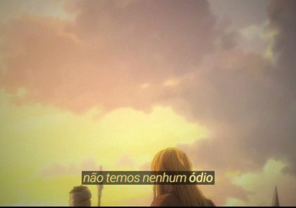
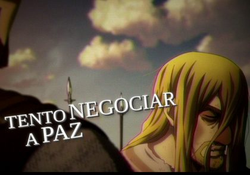
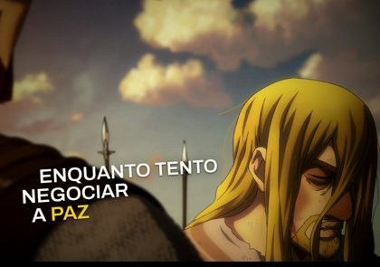
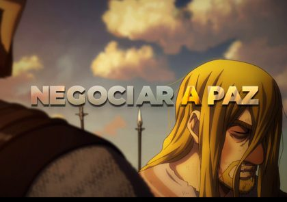
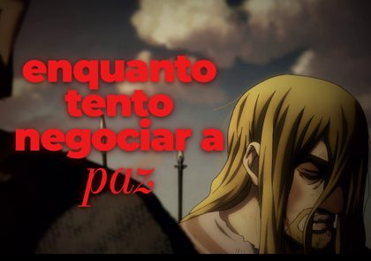
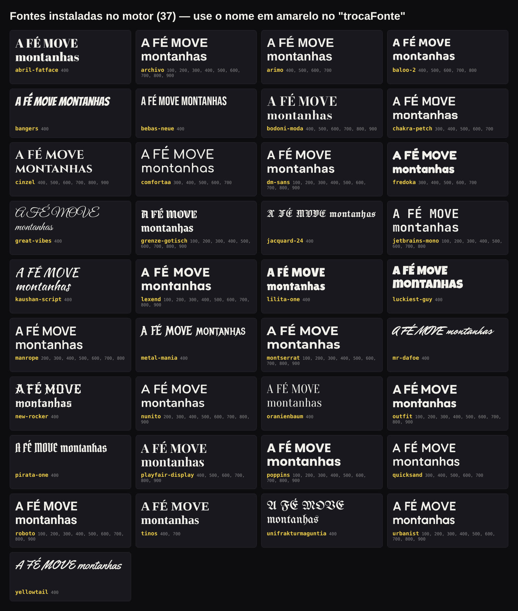

# 3 · Legendas

Cada uma é um estilo completo de legenda animada. Dá para trocar a fonte de qualquer uma (`/fontes`) e somar os efeitos que quiser.

**Instalar só este grupo:** `bash skills/instalar.sh ~/meu-canal legendas`

<table>
<tr>
<td width="33%" valign="top"> <b><code>/sample-yellow</code></b> Legenda de TV amarela em itálico, palavra por palavra numa caixinha escura. Embaixo ou em 2 linhas ao lado do personagem.</td>
<td width="33%" valign="top"> <b><code>/legenda-dinamica</code></b> Serifa itálica elegante ao lado de quem fala, mudando de canto; palavra-chave vermelha; vídeo escuro com cara de filme.</td>
<td width="33%" valign="top"> <b><code>/legenda-3d-invisivel</code></b> Uma palavra por vez no centro, maiúscula grossa com relevo 3D; palavra-chave azul-gelo; textura de mangá.</td>
</tr>
<tr>
<td width="33%" valign="top"> <b><code>/mistury</code></b> Cada frase vira um cartaz com fontes misturadas: palavra forte grande, apoio pequeno e cursiva escrita na hora.</td>
<td width="33%" valign="top"> <b><code>/street</code></b> Legenda pequena sílaba por sílaba e gritos GIGANTES em letra gótica, com colagem de outros momentos do vídeo.</td>
<td width="33%" valign="top"> <b><code>/rocks</code></b> Maiúsculas serifadas cromadas num plano inclinado, em escada, com capitular gigante e cara de VHS.</td>
</tr>
<tr>
<td width="33%" valign="top"> <b><code>/samplerocks</code></b> O layout inclinado do Rocks com letra sem serifa branca e palavras amarelas que entram esticadas.</td>
<td width="33%" valign="top"> <b><code>/invisible</code></b> A letra é feita da própria imagem do vídeo, como vidro, e pega as cores de cada cena.</td>
<td width="33%" valign="top"> <b><code>/red-sharp</code></b> Legenda pequena numa tarja preta e frases de impacto vermelhas empilhadas, com soco e tremida.</td>
</tr>
<tr>
<td width="33%" valign="top"> <b><code>/fontes</code></b> Troca a fonte de qualquer legenda: 37 fontes prontas (mostruário) ou qualquer uma do Google Fonts.</td>
</tr>
</table>

---
[← voltar ao catálogo](../README.md)
