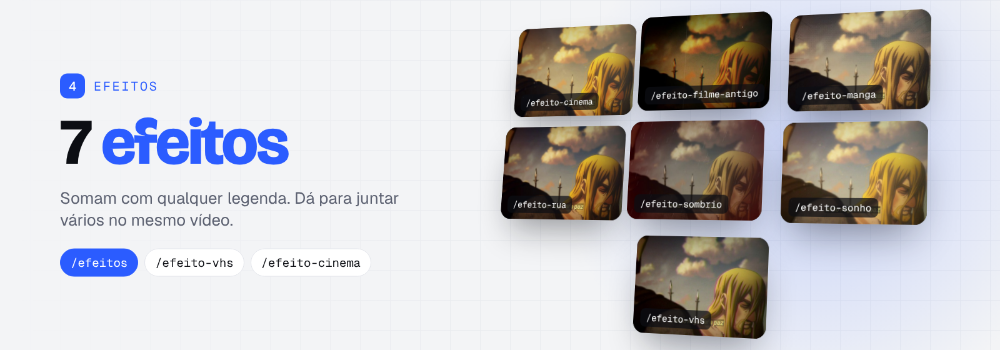
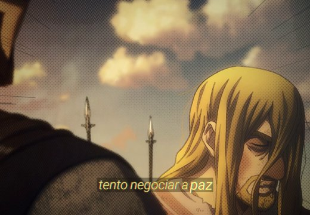
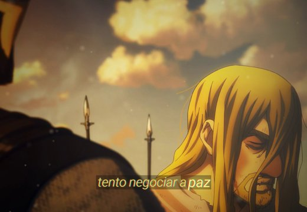
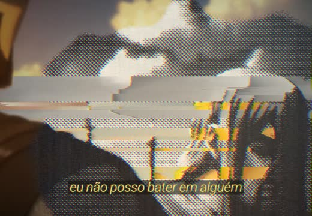

# 4 · Efeitos

Pacotes de efeito que somam com qualquer legenda. Peça um ou vários no mesmo vídeo: eles se juntam na ordem pedida.

**Instalar só este grupo:** `bash skills/instalar.sh ~/meu-canal efeitos`

### `/efeitos`
Índice: mostra os pacotes instalados, aplica um ou mais e mistura duas legendas no mesmo vídeo.

Pasta: [`efeitos/`](efeitos/) · Precisa de: motor + uma legenda

<table>
<tr>
<td width="33%" valign="top"> <b><code>/efeito-filme-antigo</code></b> Super 8 escuro: cor quente, grão forte, poeira, riscos e janela de projetor.</td>
<td width="33%" valign="top"> <b><code>/efeito-manga</code></b> Luz dourada com traço de tinta, retícula e hachura de mangá e linhas de impacto.</td>
<td width="33%" valign="top"> <b><code>/efeito-sonho</code></b> Brilho estourado suave, vazamentos de luz, poeira de luz flutuando e risco verde de glitch.</td>
</tr>
<tr>
<td width="33%" valign="top"> <b><code>/efeito-vhs</code></b> Fita VHS: imagem macia, borda colorida, varredura, tracking e clarão nos cortes.</td>
<td width="33%" valign="top"> <b><code>/efeito-sombrio</code></b> Frio e quase sem cor, com chuva fina e bordas pulsando em vermelho.</td>
<td width="33%" valign="top"> <b><code>/efeito-cinema</code></b> Cor de cinema (azul-petróleo e laranja), feixes de luz e poeira de luz.</td>
</tr>
<tr>
<td width="33%" valign="top"> <b><code>/efeito-rua</code></b> Escuro e contrastado, colagem de painéis e glitch nos cortes.</td>
<td width="33%" valign="top"> <b><code>/efeito-xerox</code></b> Cópia de xerox que invade a imagem nos cortes: retícula, rastros de pixel sort, glitch e RGB separado, e volta ao normal.</td>
</tr>
</table>

---
[← voltar ao catálogo](../README.md)
