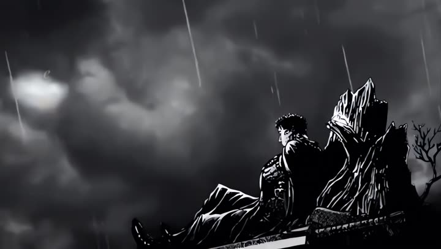

# 5 · Formatos de vídeo

O tipo de vídeo: de onde vem a imagem e como ela se mexe. Junte com qualquer legenda e efeito.

**Instalar só este grupo:** `bash skills/instalar.sh ~/meu-canal formatos-de-video`

### `/aesthetic`
Tela cheia de imagens paradas que ganham vida: quadrinhos, estrelas, zoom e cortes na batida.

Pasta: [`aesthetic/`](aesthetic/) · Precisa de: motor

<table>
<tr>
<td width="33%" valign="top"> <b><code>/video-gif</code></b> Um GIF em loop sem emenda, ampliado com IA, no meio da tela vertical, com a legenda ao lado do personagem.</td>
<td width="33%" valign="top"> <b><code>/video-narracao</code></b> Narração de um roteiro sobre cenas de fundo, com zoom lento e a referência no topo.</td>
<td width="33%" valign="top"> <b><code>/video-fala</code></b> Cena com o áudio original: a legenda fica ao lado de quem fala, nunca em cima do rosto.</td>
</tr>
<tr>
<td width="33%" valign="top"> <b><code>/edit-musica</code></b> Você digita um nome ("Goku", "Neymar"): ele busca artes que já existem, anima em camadas e corta na batida.</td>
<td width="33%" valign="top"> <b><code>/video-longo</code></b> Vídeo horizontal para o YouTube normal (10 a 30 min), com legenda num canto e capítulos.</td>
</tr>
</table>

---
[← voltar ao catálogo](../README.md)
