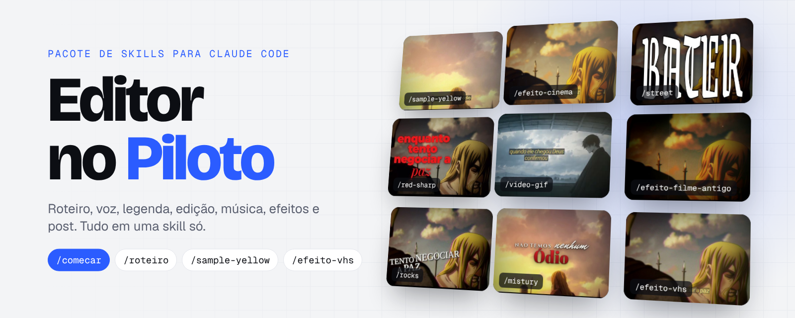
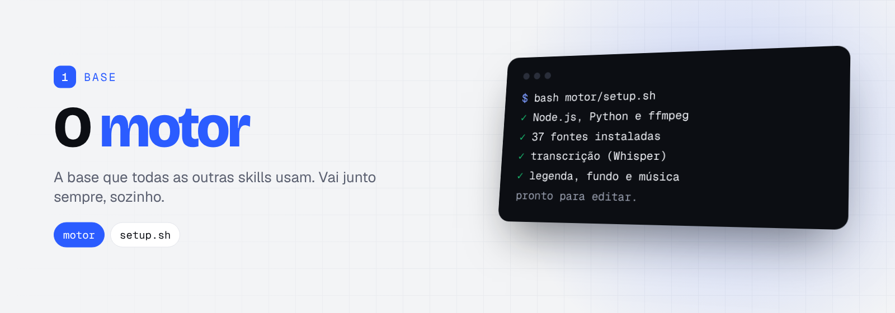
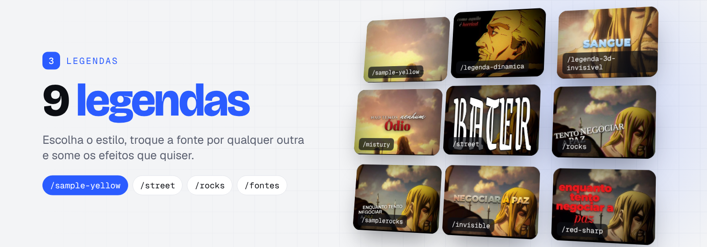
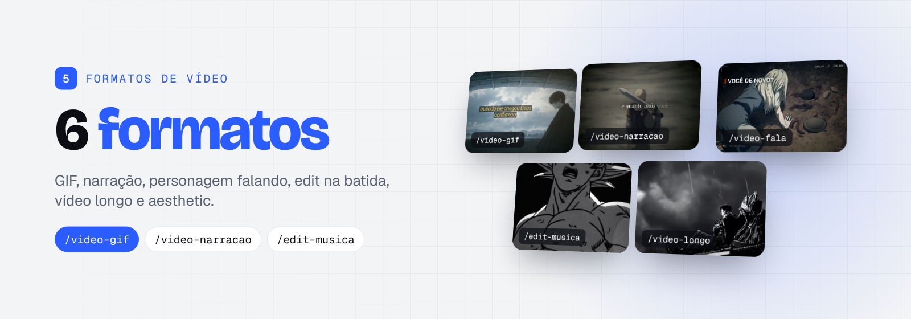

# Editor no Piloto · skills

30 skills para o Claude Code que fazem vídeos curtos (Reels, TikTok, Shorts) a partir de uma frase: roteiro, voz, legenda,
edição, música, efeitos e post. Cada skill é independente: instale todas ou só as que quiser. O **motor** vai junto sempre.

## As pastas

<table>
<tr>
<td width="50%" valign="top"><a href="1-base/"></a><br><b><a href="1-base/">1 · Base</a></b> <sub>(1)</sub><br><sub>A base que todas as outras skills usam. O instalador coloca ela junto sempre, você não precisa pedir.</sub></td>
<td width="50%" valign="top"><a href="2-roteiro-voz-post/"></a><br><b><a href="2-roteiro-voz-post/">2 · Começo, roteiro, voz e post</a></b> <sub>(5)</sub><br><sub>Tudo o que vem antes e depois da edição: você conta a ideia, ele escreve, narra, acha o fundo e entrega o texto para postar.</sub></td>
</tr>
<tr>
<td width="50%" valign="top"><a href="3-legendas/"></a><br><b><a href="3-legendas/">3 · Legendas</a></b> <sub>(10)</sub><br><sub>Cada uma é um estilo completo de legenda animada. Dá para trocar a fonte de qualquer uma (`/fontes`) e somar os efeitos que quiser.</sub></td>
<td width="50%" valign="top"><a href="4-efeitos/"></a><br><b><a href="4-efeitos/">4 · Efeitos</a></b> <sub>(8)</sub><br><sub>Pacotes de efeito que somam com qualquer legenda. Peça um ou vários no mesmo vídeo: eles se juntam na ordem pedida.</sub></td>
</tr>
<tr>
<td width="50%" valign="top"><a href="5-formatos-de-video/"></a><br><b><a href="5-formatos-de-video/">5 · Formatos de vídeo</a></b> <sub>(6)</sub><br><sub>O tipo de vídeo: de onde vem a imagem e como ela se mexe. Junte com qualquer legenda e efeito.</sub></td>
</tr>
</table>

## Como instalar

**Pelo Claude Code (mais fácil):** abra o Claude Code na pasta do seu canal e peça:
> Instale as skills sample-yellow e video-gif do Editor no Piloto nesta pasta.

**Pelo terminal:**
```bash
# 1. descompacte o Editor no Piloto
# 2. instale na pasta do seu canal (o motor vai junto). Dá para pedir skills soltas ou grupos inteiros:
bash skills/instalar.sh ~/meu-canal sample-yellow efeito-vhs video-gif
bash skills/instalar.sh ~/meu-canal legendas efeitos
#    sem nomes = instala todas:
bash skills/instalar.sh ~/meu-canal
# 3. prepare o motor uma vez:
bash ~/meu-canal/motor/setup.sh
```
Grupos: `base`, `roteiro-voz-post`, `legendas`, `efeitos`, `formatos-de-video`.
No Windows, rode pelo **Git Bash** (vem com o Git para Windows) ou peça ao Claude Code para instalar.

**Quero só uma, sem instalador:** copie a pasta da skill para `meu-canal/.claude/skills/` e o conteúdo da pasta `arquivos/`
dela para `meu-canal/motor/` (faça o mesmo com a skill `motor`, em `1-base/`).

> As pastas de grupo (1-base, 3-legendas...) existem só para organizar aqui. No seu canal, todas as skills ficam lado a lado
> em `.claude/skills/`, que é onde o Claude Code procura.

## O que você precisa
- Claude Code com plano pago (Pro ou superior), no computador ou na nuvem.
- Node.js 20+, Python 3.10+ e ffmpeg (o `setup.sh` avisa o que falta; na nuvem já vem quase tudo).
- Para a voz: conta no ElevenLabs ou no Fish Audio (gratuito), ou a sua voz gravada.

## Junte do seu jeito (legenda + fonte + efeitos)
Tudo se combina. Peça em português, do seu jeito:
- **Legenda + fonte de outra:** "Faz com a /sample-yellow, só que com a fonte gótica da Street (pirata-one)". A legenda continua
  baixinha, com a caixinha e a animação da Sample Yellow; só a letra muda. Mostruário: `3-legendas/fontes/mostruario.jpg`.
- **Vários efeitos juntos:** "/red-sharp com /efeito-filme-antigo e /efeito-vhs". Os efeitos se somam, na ordem pedida.
- **Duas legendas no mesmo vídeo:** Sample Yellow no vídeo todo e Red Sharp só na frase de impacto.
- São mais de 40 mil combinações: 9 legendas × 38 opções de fonte × qualquer mistura dos 7 efeitos.

Por dentro (no `lado.json` do projeto): `"estilo": "sample-yellow", "trocaFonte": "pirata-one", "pacote": ["cinema", "sonho"]`.

## Como cada skill é organizada
```
3-legendas/              grupo (só para organizar)
  README.md              vitrine do grupo
  capa.png
  sample-yellow/
    SKILL.md             instruções que o Claude segue (vira o comando /sample-yellow)
    exemplo.jpg          como fica
    arquivos/            arquivos do motor que esta skill acrescenta (vão para motor/ na instalação)
```

## Todos os comandos

**[Base](1-base/)**

| Comando | O que faz | Precisa de |
|---|---|---|
| `motor` | O motor de edição: instala o que precisa, junta e normaliza a voz, acha o tempo de cada palavra usando o seu texto, monta o fundo, renderiza a legenda, mistura a música e confere o vídeo final. | Node.js 20+, Python 3.10+, ffmpeg |

**[Começo, roteiro, voz e post](2-roteiro-voz-post/)**

| Comando | O que faz | Precisa de |
|---|---|---|
| `/comecar` | Você conta a ideia do canal ("quero um canal de motivação com cenas de anime"). Ele faz poucas perguntas, cria o perfil do canal e sugere legenda, efeito, formato e voz. | — |
| `/roteiro` | A partir de um tema, entrega 3 roteiros com 3 ganchos cada, de 45 a 60 segundos, com linguagem de gente e sem cara de texto de IA. | — |
| `/voz` | Gera a narração pelo ElevenLabs conectado, ou passa o passo a passo do Fish Audio (gratuito, vozes de personagens), ou usa a sua voz gravada. | conta no ElevenLabs ou Fish Audio |
| `/buscar-midia` | Procura GIFs, fotos, animações e cenas na internet, mostra as opções, baixa a escolhida e anota a fonte. Diz quais sites liberar se a rede bloquear. | acesso à internet |
| `/post` | Quando o vídeo é aprovado, entrega título, legenda do Instagram/TikTok, descrição e tags do YouTube, além de horários para postar. | — |

**[Legendas](3-legendas/)**

| Comando | O que faz | Precisa de |
|---|---|---|
| `/sample-yellow` | Legenda de TV amarela em itálico, palavra por palavra numa caixinha escura. Embaixo ou em 2 linhas ao lado do personagem. | motor |
| `/legenda-dinamica` | Serifa itálica elegante ao lado de quem fala, mudando de canto; palavra-chave vermelha; vídeo escuro com cara de filme. | motor |
| `/legenda-3d-invisivel` | Uma palavra por vez no centro, maiúscula grossa com relevo 3D; palavra-chave azul-gelo; textura de mangá. | motor |
| `/mistury` | Cada frase vira um cartaz com fontes misturadas: palavra forte grande, apoio pequeno e cursiva escrita na hora. | motor |
| `/street` | Legenda pequena sílaba por sílaba e gritos GIGANTES em letra gótica, com colagem de outros momentos do vídeo. | motor |
| `/rocks` | Maiúsculas serifadas cromadas num plano inclinado, em escada, com capitular gigante e cara de VHS. | motor |
| `/samplerocks` | O layout inclinado do Rocks com letra sem serifa branca e palavras amarelas que entram esticadas. | motor |
| `/invisible` | A letra é feita da própria imagem do vídeo, como vidro, e pega as cores de cada cena. | motor |
| `/red-sharp` | Legenda pequena numa tarja preta e frases de impacto vermelhas empilhadas, com soco e tremida. | motor |
| `/fontes` | Troca a fonte de qualquer legenda: 37 fontes prontas (mostruário) ou qualquer uma do Google Fonts. | motor + uma legenda |

**[Efeitos](4-efeitos/)**

| Comando | O que faz | Precisa de |
|---|---|---|
| `/efeitos` | Índice: mostra os pacotes instalados, aplica um ou mais e mistura duas legendas no mesmo vídeo. | motor + uma legenda |
| `/efeito-filme-antigo` | Super 8 escuro: cor quente, grão forte, poeira, riscos e janela de projetor. | motor + uma legenda |
| `/efeito-manga` | Luz dourada com traço de tinta, retícula e hachura de mangá e linhas de impacto. | motor + uma legenda |
| `/efeito-sonho` | Brilho estourado suave, vazamentos de luz, poeira de luz flutuando e risco verde de glitch. | motor + uma legenda |
| `/efeito-vhs` | Fita VHS: imagem macia, borda colorida, varredura, tracking e clarão nos cortes. | motor + uma legenda |
| `/efeito-sombrio` | Frio e quase sem cor, com chuva fina e bordas pulsando em vermelho. | motor + uma legenda |
| `/efeito-cinema` | Cor de cinema (azul-petróleo e laranja), feixes de luz e poeira de luz. | motor + uma legenda |
| `/efeito-rua` | Escuro e contrastado, colagem de painéis e glitch nos cortes. | motor + uma legenda |

**[Formatos de vídeo](5-formatos-de-video/)**

| Comando | O que faz | Precisa de |
|---|---|---|
| `/video-gif` | Um GIF em loop sem emenda, ampliado com IA, no meio da tela vertical, com a legenda ao lado do personagem. | motor + uma legenda |
| `/video-narracao` | Narração de um roteiro sobre cenas de fundo, com zoom lento e a referência no topo. | motor + uma legenda |
| `/video-fala` | Cena com o áudio original: a legenda fica ao lado de quem fala, nunca em cima do rosto. | motor + uma legenda |
| `/edit-musica` | Você digita um nome ("Goku", "Neymar"): ele busca artes que já existem, anima em camadas e corta na batida. | Python + ffmpeg |
| `/video-longo` | Vídeo horizontal para o YouTube normal (10 a 30 min), com legenda num canto e capítulos. | motor |
| `/aesthetic` | Tela cheia de imagens paradas que ganham vida: quadrinhos, estrelas, zoom e cortes na batida. | motor |

## Em breve
- `/musica`: biblioteca de músicas com ficha (clima, energia, ponto de entrada) e escolha automática da trilha certa para cada vídeo.

## Licenças de terceiros
- Fontes: pacotes @fontsource (licença OFL), instalados pelo `setup.sh`.
- Transcrição: modelo Whisper small (Apache-2.0), instalado pelo `setup.sh`.
- Ampliação com IA (video-gif): pesos do Real-ESRGAN (BSD 3-Clause), ver `5-formatos-de-video/video-gif/LICENCA-REAL-ESRGAN.txt`.
